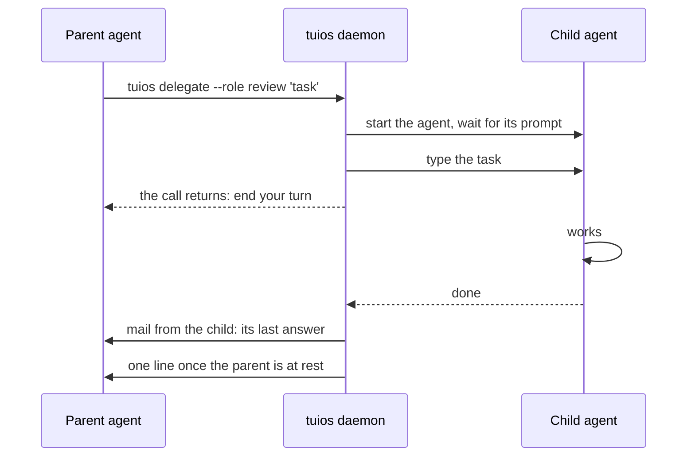

An agent that works on something big often wants a second pair of hands: a
review of the diff it just wrote, a search through a part of the code it has not
read, tests for a parser. Harnesses have their own subagents for that, but they
live inside one harness and one process. tuios already runs agents in panes, so
an agent asking tuios for another agent was the obvious next step.

`tuios start-agent` could already start one. What it could not do was the rest
of the job: link the new agent to the one that asked, get its answer back, and
keep it on a leash. `tuios delegate` is that.

```bash
# From an agent's pane. Then end your turn.
tuios delegate --role review 'Review the diff on this branch and list the bugs.'
```

## The round trip



The parent does not sit in a loop waiting. Without `--wait`, `delegate` returns
at once and tells the parent to end its turn. When the child's state says it
finished, the daemon reads the child's last answer, from its transcript when the
harness keeps one, and mails it to the parent, from the child. Then the mail
wake types one line into the parent once it is at rest, and the parent reads the
answer like any other mail. When several children finish together, the parent
still gets one line, which counts them: `Child agents finished: 2 done.`

With `--wait 5m` (at most 10 minutes) the call waits for the outcome instead,
for a script that wants the answer in one step. A timeout does not stop the
child. Its answer then comes by mail as before.

The task is typed only once the child is at its prompt. Here is what that looks
like when a child never gets there, from a run where I gave it a program that
is not a real agent:

```
The task was not given to review (25fd1a73): it reads none. The agent showed
no sign of being at its prompt before ready_timeout. The pane is kept: look at
it with capture-pane. The child agent was not ready, so the task was not typed.
The pane is kept.
```

Nothing is typed into a pane that is not ready for it, and the pane is kept so
you can see why.

## A child is never wider than its parent

While building this, I found a hole in `start-agent` itself, and it is the part
that needed the most care. A pane that holds `admin` and starts a pane without
naming its grants gave it the
default grants of `[agents.permissions]`. Under `strict`, that default can hold
`respond`, the right to answer prompts, which `admin` does not include. So a
child could answer prompts its parent could not.

The same went for the harness's own permission mode. An agent in plan mode
could start a child with `claude --dangerously-skip-permissions`.

Both are closed now:

- A child gets no grant its parent does not hold. The default is cut to what the
  parent holds.
- The daemon reads the calling agent's permission mode from its process and its
  command line, ranks both modes on one scale (for Claude Code, Codex, Copilot
  and Gemini CLI), and refuses a child that asks for a wider one. A child that
  names no mode, where the harness default would be wider, starts in the
  parent's mode.

That covers every way to open a pane: `start-agent`, `fan`, `new-window` and the
rest. You, typing outside every pane, are not held to it.

`--role review` and `--role research` start the child with the `read` grant
only, unless you pass `--grants`, since a reviewer has no reason to type into
other panes.

## Questions go up, approvals stay with you

A child can stop for two reasons that look alike and are not.

A **question** ("SQLite or Postgres?") goes to the parent first, by mail. The
Inbox holds it for 10 minutes as "With the parent agent": you can see it and
answer it, but it does not alert you. If the parent does not deal with it, it
becomes a normal Inbox item. `[agents.mail] questions_to_parent = false` sends
every such question straight to you.

An **approval** ("Allow Bash: rm -rf build/?") is yours alone. No pane, whatever
it holds, may type into it or answer it. A parent that could approve its child's
commands would be a way around every approval, so it cannot.

## Seeing the family

The link is kept by the daemon: each child records its parent and the root of
the chain, and the link survives a restart and a live upgrade. A chain stops at
8 agents. `list-agents` shows the parent, the root and the depth, and the
selector takes `parent:` and `root:`.

In the rail, the parent's row gets a line over its children, such as
`4 agents · 1 needs you · 2 working · 1 done`, and a click folds them. In the
parent's thread, the card that started them shows a pill for each child with its
state. <kbd>.</kbd> steps through them, and <kbd>Enter</kbd> opens that child's
thread.

`--isolation worktree` starts the child in a new worktree made from the
parent's commit, in a session of its own, for work that changes files. It does
not have the parent's uncommitted changes, which is worth knowing before you
ask a child to test something you have not committed.

The flags are in [Agent Messaging](/docs/agent-messaging#delegate).
