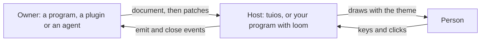

import { Callout } from 'fumadocs-ui/components/callout';
import { Since } from '@/components/mdx/since';

`tuios.dev/tml` is the TML language. A TML document is a tree of components from a fixed catalog, with a JSON state store. A program, a plugin or an agent sends one to a host, and the host draws it in a pane, a popup or a dock cell. This library is the language. It draws nothing. [loom](/docs/libraries/loom) draws it.

<LibShot
  name="tml/hero"
  alt="A test run drawn from one TML document: tabs, stat tiles with sparklines, a pass-rate gauge, a bar chart by package, a line chart of past runs, a failures table with a cursor row and a row of buttons, in the frame tuios draws around a surface"
  caption="One TML document, drawn by loom in the frame tuios puts around a surface. Every picture on this page is drawn from real code by the docs build scripts."
/>

The library uses only the standard library. The API reference is on [pkg.go.dev](https://pkg.go.dev/tuios.dev/tml).

## Quickstart

```bash
go get tuios.dev/tml tuios.dev/loom
```

This program checks a document, draws it, changes its state with a JSON Patch and draws it again:

<include cwd lang="go" meta='title="main.go"'>tools/libshots/snippets/tml-quickstart.txt</include>

<LibShot name="tml/quickstart" alt="The output of the program: the Build card at 40 percent with the step Compiling, then the same card at 80 percent with the step Linking" />

## How it works

A document has two parts: a tree of components and a JSON state. Attributes read the state through bindings, such as `{state.pct / 100}`. The owner of a surface changes the state with JSON Patch, and the host draws again only what reads the changed paths.



- **Two encodings.** TML text is a strict XML subset for files and people. TML JSON is for the wire and for agents. Both parsers give the same canonical tree, and a canonical tree prints and reads back unchanged in either encoding.
- **Roles, never colours.** A colour is a theme role, such as `success` or `mute`. A hex colour is an error, so every surface follows the theme of the host.
- **No code runs.** Expressions compute values. They cannot loop, assign or call out, and each frame has a step budget.
- **Local actions.** Tabs, sorting, the cursor, `set` and `toggle` run in the host at once. `emit` and `close` go back to the owner as events.

The same document in TML text and in TML JSON:

```xml
<tml version="1" title="Build">
  <state>{"pct": 40, "step": "Compiling"}</state>
  <card title="Build">
    <text>Step: <b>{state.step}</b></text>
    <progress value="{state.pct / 100}"/>
  </card>
</tml>
```

```json
{"type": "tml", "version": 1, "title": "Build", "state": {"pct": 40, "step": "Compiling"},
 "children": [{"type": "card", "title": "Build", "children": [
   {"type": "text", "children": ["Step: ", {"type": "b", "children": ["{state.step}"]}]},
   {"type": "progress", "value": "{state.pct / 100}"}]}]}
```

The root is `tml`, or one block component for a small surface, such as a dock cell. The examples below use both forms.

## Components

Each picture is the TML above it, drawn by loom in the site's theme.

### Layout

`row` lays its children out left to right, and `col` top to bottom. `gap` puts empty cells between children. `justify` and `align` place them. A `spacer` takes the free space.

<include cwd lang="xml">tools/libshots/scenes/tml/layout-row.tml</include>

<LibShot name="tml/layout-row" alt="Badges in a row with a gap, text pushed to the right by a spacer, a centred badge, and three badges spread across the row" />

<include cwd lang="xml">tools/libshots/scenes/tml/layout-col.tml</include>

<LibShot name="tml/layout-col" alt="Two columns: badges stacked with one empty row between them, and badges aligned to the right edge" />

`w` and `h` take cells, a percentage, `fill` or `fill:N`. A `fill` box shares the free space with the other `fill` boxes, by its weight N. `min-w`, `max-w`, `min-h` and `max-h` bound a size. `pad` takes one, two or four cell counts.

<include cwd lang="xml">tools/libshots/scenes/tml/layout-fill.tml</include>

<LibShot name="tml/layout-fill" alt="Two rows of stat tiles. In the first, a fixed tile of 14 cells, a tile with one share and a tile with two shares. In the second, a quarter, a tile capped at 18 cells and a tile that takes the rest" />

`grid` wraps its children into equal columns:

<include cwd lang="xml">tools/libshots/scenes/tml/layout-grid.tml</include>

<LibShot name="tml/layout-grid" alt="Six stats in a grid of three columns" />

`stack` layers its children, `scroll` scrolls them, and `split` holds two children with a divider that a person can drag.

### Text

`text` holds inline components: `b`, `i`, `u`, `s`, `code`, `c` (a colour role), `kbd` and `a` (a link). `heading` has three levels.

<include cwd lang="xml">tools/libshots/scenes/tml/text.tml</include>

<LibShot name="tml/text" alt="A first-level heading, a second-level heading with a rule, a paragraph with bold, italic, underline, strike, inline code, a green phrase, a key and a link, and a right-aligned muted line" />

### Stat, gauge and progress

A `stat` is a labelled number. With a height of 3 it is a tile. A `gauge` shows a value against a maximum. A `progress` bar takes a value from 0 to 1.

<include cwd lang="xml">tools/libshots/scenes/tml/stat.tml</include>

<LibShot name="tml/stat" alt="Three stats on one line with their deltas, and the same three stats as tiles with a coloured edge" />

<include cwd lang="xml">tools/libshots/scenes/tml/gauge.tml</include>

<LibShot name="tml/gauge" alt="A CPU gauge at 43 percent, a green gauge at 98.8 percent, a progress bar at 40 percent and a green progress bar labelled 3 of 4" />

### Badge and status

A `badge` is a short coloured tag. `status` shows the tuios agent state glyph and word. `spinner` is a busy mark.

<include cwd lang="xml">tools/libshots/scenes/tml/badge.tml</include>

<LibShot name="tml/badge" alt="Five badges in different roles, the five agent states working, needs input, done, errored and idle, and a spinner labelled Compiling" />

### Table

A `table` shows the rows of a state array. Each `column` names a field. `format` is an expression for the cell, with `value` and `row`. `sort` gives the first order, and `select="single"` gives a cursor.

<include cwd lang="xml">tools/libshots/scenes/tml/table.tml</include>

<LibShot name="tml/table" alt="A table of five failed tests with package, test and time columns, sorted by time from the longest, with the cursor on the first row" />

### List, tree and kv

A `list` repeats its children once per element of a state array. A `tree` shows nested state objects. A `kv` shows key and value pairs in two aligned columns. A long value wraps onto more rows under its value column.

<include cwd lang="xml">tools/libshots/scenes/tml/list.tml</include>

<LibShot name="tml/list" alt="A list of three agents with their tasks and states, with the cursor on the first" />

<LibGallery>
<div>

<include cwd lang="xml">tools/libshots/scenes/tml/tree.tml</include>

<LibShot name="tml/tree" alt="A file tree two levels open: cmd and tuios with two files, loom with two files, and go.mod" />

</div>
<div>

<include cwd lang="xml">tools/libshots/scenes/tml/kv.tml</include>

<LibShot name="tml/kv" alt="Four key and value pairs: branch, ahead, risk in the warning colour, and diff" />

</div>
</LibGallery>

### Card and tabs

A `card` is a titled block that a person can fold. `tabs` shows one `tab` at a time. A tab title can hold a binding.

<include cwd lang="xml">tools/libshots/scenes/tml/card.tml</include>

<LibShot name="tml/card" alt="An open card titled Failures 3 with two lines of text, and a folded card titled Passed 412" />

<include cwd lang="xml">tools/libshots/scenes/tml/tabs.tml</include>

<LibShot name="tml/tabs" alt="Three tabs, Summary, Failures 3 and Log, with the Summary tab open" />

`modal` is a box that holds the focus while it is open. `toast` is a short notice that goes away.

### Charts

`bar`, `line`, `area`, `sparkline`, `histogram`, `heatmap` and `pie` read a state array. `x`, `y` and `v` name the fields. [plot](/docs/libraries/plot) draws them.

<include cwd lang="xml">tools/libshots/scenes/tml/charts.tml</include>

<LibShot name="tml/charts" alt="Four charts in a grid: horizontal bars of seconds by package, a line of suite time, columns of wall time, and a donut of lines by language with its legend" />

### Mermaid

`mermaid` holds a Mermaid diagram. loom draws it as text with [sketch](/docs/libraries/sketch), fitted to the width of the element, in the theme's colours. A diagram taller than its box scrolls with the wheel. A diagram that sketch cannot draw shows its source under a note that says why.

```xml
<tml version="1">
  <mermaid>
flowchart LR
  P[Prompt] --> A[Agent works]
  A --> R[Review]
  R --> S[Ship]
  </mermaid>
</tml>
```

`tuios tml render` draws it like this:

```
┌─────────┐      ┌─────────────┐      ┌─────────┐     ┌──────┐
│ Prompt  │─────►│ Agent works │─────►│ Review  │────►│ Ship │
└─────────┘      └─────────────┘      └─────────┘     └──────┘
```

The text of a `mermaid` element is kept as written. Bindings do not apply in it.

### Forms

`form`, `input`, `textarea`, `select`, `checkbox`, `toggle` and `slider` collect values, and `button` with `submit` sends them. loom shows each field with its label and value. Editing comes in a later release.

## State and bindings

A value in braces is a binding: one expression that reads the state. The language is small and total. Every expression gives a value, and a mismatch gives `null`.

<include cwd lang="xml">tools/libshots/scenes/tml/bindings.tml</include>

<LibShot name="tml/bindings" alt="Six bound values: the branch in capitals, a pass rate of 99.3 percent, a wall time of 18.41 seconds, a memory size of 35M, the result 3 failed, and the fallback text no value" />

- Paths: `state.a.b`, `state.items[0]`, `item.x` inside `each`, `form.tag` inside a form, `event.value` inside an action, and `view.width`.
- Operators: `+ - * / %`, comparisons, `&& || !`, `a ? b : c`, and `??` for a null value.
- Functions: `len`, `sum`, `avg`, `min`, `max`, `round`, `abs`, `pct`, `fmt`, `dur`, `bytes`, `ago`, `upper`, `lower`, `trim`, `join`, `contains`, `starts`, `pick` and `count`.
- `each="state.items" as="item"` repeats a node. `if` drops a node when false. `show` hides it and keeps its space.

Each surface has a budget of 10,000 steps per frame. Past the budget, a binding shows `!`. Each expression records the state paths it reads, so a renderer draws again only what a patch touches.

## Update with JSON Patch

The owner changes the state with an RFC 6902 JSON Patch. A patch is atomic: it applies in full, or not at all. The size limit is checked after every operation.

<include cwd lang="json" meta='title="patch.json"'>tools/libshots/scenes/tml/build-patch.json</include>

<include cwd lang="xml">tools/libshots/scenes/tml/build.tml</include>

<LibGallery>
<LibShot name="tml/patch-before" alt="Before the patch: step Compiling, 2 steps, progress at 40 percent and two commands" caption="Before the patch" />
<LibShot name="tml/patch-after" alt="After the patch: step Linking, 3 steps, progress at 80 percent and three commands" caption="After the patch" />
</LibGallery>

In Go:

```go
store, err := tml.StoreFor(doc, nil) // nil means the default limits
if err != nil {
	return err
}
ops, err := tml.DecodePatch(patch, nil)
if err != nil {
	return err
}
changed, err := store.Apply(ops) // the JSON Pointers that changed, such as [/pct /step /log]
```

A patch with a `test` operation that no longer matches is refused. Read the state again, then send a new patch.

## Events and actions

An action attribute, such as `on-press`, holds one or more calls separated by `;`. A button's `key` works from anywhere on the surface.

<include cwd lang="xml">tools/libshots/scenes/tml/confirm.tml</include>

<LibShot name="tml/confirm" alt="A question, Deploy v0.11.0 with 2 risky changes, and three buttons: Deploy with the key y, Cancel with n, and Show diff with d" />

loom runs the local actions. The others come back to the program. Pressing <kbd>d</kbd> and then <kbd>y</kbd> on this surface returns:

<include cwd lang="text">tools/libshots/snippets/tml-confirm-keys.txt</include>

| Action | Runs | Effect |
| --- | --- | --- |
| `set('path', expr)`, `toggle('path')` | Locally | Change the state. |
| `tab('id')`, `sort('field')`, `filter('id', expr)`, `fold('id')`, `focus('id')` | Locally | Change the view. |
| `emit('name', expr)` | Owner | Send an event. |
| `close(expr)` | Owner | Close the surface with a value. |
| `copy(expr)` | Host | Put text on the clipboard. |
| `open('file:path')` | Host | Open a file under the owner's files folder. |
| `pane('verb', ...)` | Host | Run `focus`, `new-window` or `send-text` under the owner's grants. |

## Errors that name the fix

`tml.Check` reports up to 20 problems in one pass. Each problem has a line and a column, a JSON Pointer to the node, a code, and the closest legal value.

<include cwd lang="xml" meta='title="broken.tml"'>tools/libshots/scenes/tml/broken.tml</include>

<include cwd lang="text">tools/libshots/snippets/tml-check-output.txt</include>

`*tml.Error` marshals to the error object a host sends back, so an agent can read each fix.

## Limits and safety

A document comes from a program, a plugin or an agent, so the library treats it as untrusted.

- No code from a document runs. Expressions cannot loop, assign or call out, and each frame has a step budget.
- The store removes control, bidi and invisible characters from every string and key it takes in: the document's state, patch values and `Set`. Evaluated bindings are cleaned too.
- A hex colour is an error. A link opens only after the person confirms it.
- `StoreFor` keeps the tree, and refuses a patch that grows `each`, `list`, the images or the rows past their limits.

| Limit | Value |
| --- | --- |
| Document | 256 KiB, 1 MiB from the person's own command line |
| Nodes | 5,000 |
| Depth | 32 |
| State | 1 MiB |
| Nodes that `each` and `list` expand to | 2,000 |
| Rows and data points, after `each` expands | 50,000 |
| Patch | 64 KiB, 100 a second per surface |
| Images | 4 per document, 4 MiB each |

For a host: give `Env.Budget` one `tml.NewBudget()` for all the bindings of a frame. A nil budget gets a fresh one for each call, which bounds one binding but not a frame.

## Show a document without tuios

The `tml` command shows a document full screen in any terminal, or prints it once as text. It is part of loom:

```bash
go install tuios.dev/loom/cmd/tml@latest
tml report.tml
```

[The tml command](/docs/libraries/loom#tml-command) on the loom page has the release archives and the flags.

## Show a document in tuios

<Callout>
`tuios tml` is in tuios v0.11.0 and later.
</Callout>

`tuios tml show FILE` shows a document as a popup or as a pane. tuios draws it with loom in your theme, and keys and the mouse work in it. The daemon keeps the surface, so it stays when you detach.

```bash
tuios tml validate test-run.tml        # check it first: each problem names the fix
tuios tml render test-run.tml          # see it drawn as text; opens nothing
tuios tml show test-run.tml --pane     # a tiled pane; it prints the surface id
```

<Shot
  name="tml-show-pane"
  light
  width={1700}
  height={1110}
  alt="The test run dashboard in a tuios pane, zoomed to fill the screen. The title bar shows Test run, then from shell."
/>

The title bar shows the document's title, then who opened the surface: "from" and the name of that pane, or its id when it has no name. The document cannot change the owner. A surface does not take the focus: click it to use it.

A text field takes typed text and a paste, in a popup, in a pane and in the agents view. <kbd>Tab</kbd> or a click goes into a field, and <kbd>Esc</kbd> leaves it. <kbd>Enter</kbd> submits the form. While a field has the focus, a button's key, such as <kbd>y</kbd>, types the letter. A paste with no field to take it tells you to select a field first.

### Read a surface as text <Since command="tml render" /> [#read-a-surface-as-text]

An agent cannot see your screen. It reads a surface as text before and after it shows it.

```bash
tuios tml render dash.tml                          # drawn at the terminal's width, or 100
tuios tml render dash.tml --width 80 --height 24 --tab log
tuios tml render dash.tml --state '{"runs":12}'
tuios capture-pane -s "$TUIOS_SESSION" -w WINDOW   # an open surface, as drawn
```

- `tml render` draws the document as tuios draws it in a pane, and opens nothing. It needs no daemon.
- The width is the terminal's width, or 100 when standard output is not a terminal. Without `--height`, the document gets the rows it needs.
- `--state` replaces the state. `--tab` opens a tab by its id. `--ansi` keeps the colours as ANSI escape sequences.
- When the document is not valid, `tml render` prints the problems and exits with status 1.
- `capture-pane` on the window of a surface prints the surface as drawn, at the window's size. It uses the surface's state and the view that a client last reported: the open tab, the cursor rows and the scroll place. `--json` adds `surface` to the result.

### Ask a question and wait for the answer

With `--wait`, the command stays open until the surface closes, and prints the value the document closed with.

```bash
answer=$(tuios tml show deploy.tml --wait)   # "yes", "no", or null
```

<Shot
  name="tml-show-popup"
  light
  width={1700}
  height={1110}
  alt="The deploy question in a dialog over the panes. Its frame reads from shell, then the title Deploy. The buttons are Deploy, Cancel and Show diff."
/>

`--wait` exits with 0 for the person's answer, 1 when the person closed the popup with no value, and 2 when a program closed it with `tuios tml close`.

### Dock a popup as a pane

You choose where a document sits. <kbd>Ctrl</kbd>+<kbd>B</kbd> <kbd>t</kbd> <kbd>f</kbd> docks the focused popup as a tiled pane, and floats a TML pane as a popup again. The `dock` control on the popup's top border and the `float` control on the pane's title bar do the same. The palette's "Toggle floating" works too.

<Shot
  name="tml-dock"
  light
  width={1700}
  height={1110}
  alt="The deploy question after Ctrl+B t f. It is a tiled pane under the api pane, named deploy, from api, with float on its title bar. The api pane still waits for the answer."
/>

The surface keeps its state and what you typed. The command that waits with `--wait` keeps waiting. A patch or a new document from the owner does not move the surface back.

Each document that an agent's pane shows is also on the agent's Artifacts tab in the agents view. There you answer a form without leaving the view. See [Artifacts](/docs/agent-inbox#artifacts).

### Own a live surface

With `--events`, the command prints one JSON line for each `emit` and for the close. A script reads the lines and answers with a patch or a new document.

```bash
tuios tml show dash.tml --pane --events     # prints tml_opened, then one line per event
tuios tml patch SURFACE '[{"op":"replace","path":"/passed","value":413}]'
tuios tml replace SURFACE next.tml --keep-state
tuios tml get SURFACE
tuios tml list
tuios tml close SURFACE '"done"'
```

From a pane, these commands need the `write` grant. Only the pane that opened a surface can patch, replace or close it. A `pane()` action runs with the grants of the pane that opened the surface, and tuios asks the person before a surface first types into a pane. The [CLI reference](/docs/cli-reference) lists every flag.

## How do I

- **Check a document before I send it?** Call `tml.Check(src, nil)`, or run `tuios tml validate FILE`.
- **Convert between TML text and JSON?** Call `tml.Format(src, tml.JSONEncoding, nil)`, or `tml.TextEncoding` for text.
- **Give an agent the format?** `tml.Schema()` returns the JSON Schema of TML JSON. It is also in the module as `tml.schema.json`.
- **Change one value?** Send a patch with one `replace` operation. Use `add` with the path `/log/-` to append to an array.
- **Change the layout with the width?** Read `view.band` in an `if`: `narrow` below 72 cells, `medium` below 120 and `wide` from 120.
- **Draw a document in my own program?** Use [loom](/docs/libraries/loom).
- **Get an answer from a person in a script?** Run `tuios tml show FILE --wait`, and use `close('value')` on the buttons.

## API overview

| Name | Does |
| --- | --- |
| [`Check`](https://pkg.go.dev/tuios.dev/tml#Check) | Parses and validates a document in either encoding. |
| [`Parse`](https://pkg.go.dev/tuios.dev/tml#Parse), [`Validate`](https://pkg.go.dev/tuios.dev/tml#Validate) | The two steps of `Check`, apart. |
| [`Format`](https://pkg.go.dev/tuios.dev/tml#Format) | Prints a document in canonical TML text or TML JSON. |
| [`Schema`](https://pkg.go.dev/tuios.dev/tml#Schema) | Returns the JSON Schema of TML JSON. |
| [`Node`](https://pkg.go.dev/tuios.dev/tml#Node) | One node of the tree: its type, attributes and children. |
| [`StoreFor`](https://pkg.go.dev/tuios.dev/tml#StoreFor), [`Store`](https://pkg.go.dev/tuios.dev/tml#Store) | The state of a document, with its limits. |
| [`DecodePatch`](https://pkg.go.dev/tuios.dev/tml#DecodePatch), [`Op`](https://pkg.go.dev/tuios.dev/tml#Op) | JSON Patch operations. |
| [`ParseTemplate`](https://pkg.go.dev/tuios.dev/tml#ParseTemplate), [`ParseExpr`](https://pkg.go.dev/tuios.dev/tml#ParseExpr), [`Env`](https://pkg.go.dev/tuios.dev/tml#Env) | Bindings and expressions, and what they read. |
| [`ParseActions`](https://pkg.go.dev/tuios.dev/tml#ParseActions) | Parses and checks an action attribute. |
| [`Problem`](https://pkg.go.dev/tuios.dev/tml#Problem), [`Error`](https://pkg.go.dev/tuios.dev/tml#Error) | A problem with its place, code and fix. |
| [`Sanitize`](https://pkg.go.dev/tuios.dev/tml#Sanitize) | Removes what must never reach a terminal. |

The [README](https://github.com/Gaurav-Gosain/tuios/tree/main/tml#readme) lists every component, attribute, function, action and limit.

## Where it fits

- [loom](/docs/libraries/loom) draws TML documents into cells. It uses tml for the tree, the store, the bindings and the actions.
- [plot](/docs/libraries/plot) draws the chart components for loom.
- tuios uses tml and loom for `tuios tml show`, and checks each document with `tml.Check` before it opens a surface.
- tml imports no other library and no tuios package.

## Versions

The module is at v0. The API can change between minor versions. Its tags have the folder name as a prefix, such as `tml/v0.1.0`. The source is in the [tml folder](https://github.com/Gaurav-Gosain/tuios/tree/main/tml) of the tuios repository, under the MIT licence.
