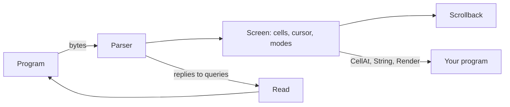

`tuios.dev/vt` is a terminal emulator in Go. It reads the bytes a program writes to a terminal and keeps the screen they draw: the cells, their colours and attributes, the cursor, the scrollback and the modes. tuios runs every pane on it.

<LibShot
  name="vt/hero"
  alt="A 40 by 12 screen that vt kept: go test output in colour, a box with bold, italic, underline, strike, reverse, faint and curly underline text, a progress line drawn over itself, and the 16 ANSI colours"
  caption="The screen vt keeps after a program printed colours, attributes, box drawing, a carriage return and an erase. shot drew the picture from vt's cells."
/>

It needs Go 1.26 or later. The default build is pure Go and needs no cgo. The API reference is on [pkg.go.dev](https://pkg.go.dev/tuios.dev/vt).

## Quickstart

```bash
go get tuios.dev/vt
```

<include cwd lang="go" meta='title="main.go"'>tools/libshots/snippets/vt-quickstart.txt</include>

<LibShot name="vt/quickstart" alt="The output of the program: the screen text hello world and a prompt, the letter w from the cell at column 6, and the cursor position 2,1" />

`String` gives every row of the screen, so the 3-row screen prints three lines.

## How it works



- `Write` takes what a program prints. The parser updates the screen and the scrollback.
- Some sequences ask the terminal a question, such as the cursor position. `Read` returns the replies, and the host writes them back to the program.
- `CellAt`, `String` and `Render` read the screen. `Callbacks` tells you what the program asks of the host, such as a new title.

With a pseudo-terminal, copy the replies back in a goroutine:

```go
go io.Copy(ptmx, term)
```

## What it covers

- VT100 to xterm sequences, with a conformance corpus in its tests.
- Scrollback with reflow on resize.
- The alternate screen, scroll regions, left and right margins, tab stops, character sets and selective erase.
- Mouse modes and key encoding, with the kitty keyboard protocol and modifyOtherKeys.
- Kitty graphics and sixel, OSC 8 links, OSC 133 shell marks, OSC 52 clipboard, desktop notifications and OSC 9;4 progress.
- OSC 7501, the [Program Status Protocol](/docs/libraries/progstatus).

## How do I

- **Check what a program drew in a test?** Write its output, then compare `term.String()` or read `CellAt`.
- **Run a real program?** Start it on a pseudo-terminal, copy its output into `Write`, and copy `Read` back to it.
- **Show a terminal inside a Bubble Tea program?** Resize the emulator with `Resize`, and put `Render` in your view.
- **Keep a screen and send it to a client later?** Use `tuios.dev/vt/snapshot`. `Replay` turns a state into the bytes that repaint it on any xterm-compatible terminal.
- **Save a picture of the screen?** Read it with [shot](/docs/libraries/shot): `shot.FromScreen(term, palette)`.
- **Fuzz my own emulator?** `tuios.dev/vt/vtgen` generates terminal input from a grammar. A failure reduces to a script of named sequences a person can read.

## API overview

| Name | Does |
| --- | --- |
| [`New`](https://pkg.go.dev/tuios.dev/vt#New), [`NewWithScrollback`](https://pkg.go.dev/tuios.dev/vt#NewWithScrollback) | Return the backend the build selected. |
| [`NewEmulator`](https://pkg.go.dev/tuios.dev/vt#NewEmulator), [`Emulator`](https://pkg.go.dev/tuios.dev/vt#Emulator) | The pure Go emulator. |
| [`Screen`](https://pkg.go.dev/tuios.dev/vt#Screen) | The small interface most users need: `Write`, `Read`, `Resize`, `Width`, `Height`, `CellAt`, `CursorPosition`, `Render`, `String` and `Close`. |
| [`Terminal`](https://pkg.go.dev/tuios.dev/vt#Terminal) | The full interface that tuios uses: scrollback, modes, key and mouse encoding, graphics, and the state a snapshot carries. |
| [`Callbacks`](https://pkg.go.dev/tuios.dev/vt#Callbacks) | What a program asks of the host: a title, a bell, a working directory, a clipboard write, a notification, and private OSC sequences. |
| [`snapshot`](https://pkg.go.dev/tuios.dev/vt/snapshot) | Capture, pack and apply an emulator's state. |
| [`vtgen`](https://pkg.go.dev/tuios.dev/vt/vtgen) | Grammar-based terminal input for fuzzing. |

## The ghostty backend

With the `ghostty` build tag, `New` returns an emulator backed by [libghostty-vt](https://github.com/ghostty-org/ghostty) through cgo. The build needs the library. See [docs/ghostty-vt.md](https://github.com/Gaurav-Gosain/tuios/blob/main/docs/ghostty-vt.md) for how tuios builds it.

## Where it fits

- tuios runs every pane on vt, in the daemon. The daemon sends a client a snapshot when it attaches.
- [shot](/docs/libraries/shot) reads a vt screen to make a picture. The pictures on these library pages that show terminal output went through vt.
- vt parses OSC 7501 with [progstatus](/docs/libraries/progstatus).

## Versions

The module is at v0. The API can change between minor versions. Its tags have the folder name as a prefix, such as `vt/v0.1.0`. The source is in the [vt folder](https://github.com/Gaurav-Gosain/tuios/tree/main/vt) of the tuios repository, under the MIT licence. It started as a copy of the vt package of [charmbracelet/x](https://github.com/charmbracelet/x).
