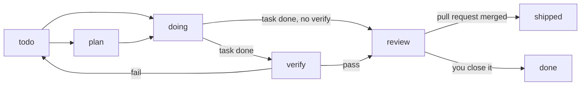

import { Callout } from 'fumadocs-ui/components/callout';
import { Since } from '@/components/mdx/since';

A task card is one unit of work: a title, the prompt for the agent that takes it, a stage, and the pane that holds it. The daemon keeps the cards, so they outlive the pane that added them, and every client and every agent sees the same board. After a daemon restart the cards come back with every holder let go.

You see the cards as a board in the agents view. Agents and scripts use `tuios task`. Both change the same cards.

## Add a card

<kbd>Ctrl</kbd>+<kbd>B</kbd> <kbd>+</kbd> <Since action="prefix_new_task" /> opens the capture sheet from any mode. The palette has it as "New task".

1. Write the task. The first line is the card's title. The rest is its prompt. Paste an image with <kbd>Ctrl</kbd>+<kbd>V</kbd>, or paste its path: the image goes to the session's file store, and the prompt names its stored path.
2. Pick the fields under the text with <kbd>Tab</kbd> and change one with the arrows:
   - **Project**: the repository of the focused pane's folder, by its origin URL. The card then shows on that repository's board in every session and on linked machines. `None, this session` keeps the card in the session.
   - **Stage**: Todo or Plan.
   - **Agent to start**: the agent <kbd>Ctrl</kbd>+<kbd>Enter</kbd> starts.
   - **Machine**, with a linked machine: This machine, Any machine (the one with the most room), or one linked machine.
3. <kbd>Enter</kbd> adds the card. <kbd>Ctrl</kbd>+<kbd>Enter</kbd> adds it and starts the agent on it, which holds the card from the start. With Plan, the agent starts in its own plan mode where it has one.

<kbd>Esc</kbd> closes the sheet and keeps the draft for the next time you open it.

From a shell, or from an agent that hands out work:

```bash
tuios task add -p 'Read api/retry.go and add a jitter option, with a test.' \
  make the backoff jitter configurable

# A card for this folder's repository
tuios task add --project . add retries to the client

# A card a person starts, never dispatch
tuios task add --ask-first rotate the staging keys
```

## The board

Open the agents view with <kbd>Ctrl</kbd>+<kbd>B</kbd> <kbd>i</kbd> and press <kbd>b</kbd>, or click `Board` in its header. The board shows one column for each stage, with the count of cards in its head:

<Shot
  name="task-board"
  width={1768}
  height={814}
  light
  alt="The task board in the agents view: Todo, Plan, Doing and Verify columns, with the count of cards in each head and 3 more columns past the right edge. In Todo, split the auth middleware is blocked and write the changelog is free. In Doing, api-2 holds port the cache to lru and api-1 holds wire the retry jitter. In Verify, docs-1 holds draft the rollout notes."
/>

A card shows its title, then its holder's mark and name (or `Blocked` and why, or `free`), its id, and how long it has been in the stage. When the columns do not fit, the board shows the columns round the cursor, and the head row counts the columns past each edge (`3›` in the picture).

| Keys | What they do |
|---|---|
| <kbd>h</kbd> <kbd>l</kbd>, <kbd>←</kbd> <kbd>→</kbd> | Go to the column before or after |
| <kbd>j</kbd> <kbd>k</kbd>, <kbd>↓</kbd> <kbd>↑</kbd> | Go to the card below or above |
| <kbd>H</kbd> <kbd>L</kbd>, <kbd>Shift</kbd>+<kbd>←</kbd> <kbd>Shift</kbd>+<kbd>→</kbd> | Move the card to the stage before or after |
| <kbd>Enter</kbd> | Go to the holder's pane. On a free card, open the New agent sheet on it |
| <kbd>n</kbd> | Add a card to the column under the cursor |
| <kbd>t</kbd> | Take the card for the pane behind the agents view |
| <kbd>v</kbd> | On a card its agent is done with, open the Changes view of that agent's worktree |
| <kbd>M</kbd> | On a card in review: Ready to merge (see [Ready to merge](#ready-to-merge)) |
| <kbd>F</kbd> | Fold or open the column. Done starts folded |
| <kbd>B</kbd> <Since action="inbox_board_layout" /> | Show the board as a list, or as columns again |
| <kbd>Ctrl</kbd>+<kbd>T</kbd> <Since action="inbox_dispatch_mode" /> | Turn dispatch from manual to pull to auto |
| <kbd>Ctrl</kbd>+<kbd>X</kbd> <Since action="inbox_dispatch_pause" /> | Pause all dispatch, or start it again |

Drag a card onto another column to move it to that stage. A click on a column head folds or opens it. Under 80 columns of screen, and after <kbd>B</kbd>, the board is a list with the stages one under the other. tuios keeps your choice. The search (<kbd>/</kbd>) narrows the cards with their holders, and with no selector it also matches a card's id and title.

`[tasks] stages` picks the stages the board shows. The order stays the same whatever the order of the list:

```toml
[tasks]
stages = ["todo", "doing", "verify"]
```

## The stages of a card

The stages are `todo`, `plan`, `doing`, `verify`, `review`, `shipped` and `done`. A claim moves a card in todo or plan to doing. When the agent says it is done, the card goes to verify when the board has a verify command, else to review. You close it, or its pull request merging moves it to shipped.



tuios also moves a card on its own when it records a fact about the card's work. Each move fires only from the stages in the table, never on a blocked or done card, and the card's history names the reason:

| Fact | From | To |
|------|------|----|
| A plan held for approval on the pane that holds the card | `todo`, `doing` | `plan` |
| The plan approved from the Inbox | `plan` | `doing` |
| `tuios fan verify` starts in the card's fan | `doing` | `verify` |
| Every attempt's check ended and none passed | `verify` | `doing` |
| A pull request on the branch opened | `plan`, `doing`, `verify` | `review` |
| The pull request merged | `plan`, `doing`, `verify`, `review` | `shipped` |
| The pull request closed with no merge | `review` | `doing` |

A plan is held only when `[agents.approvals]` holds plans for the harness and the pane is not in front of you. `auto_stage = false` leaves every stage to you:

```toml
[tasks]
auto_stage = false
```

### Verify

A verify command runs on each card its agent is done with, in the agent's worktree, on the agent's machine. It is the person's command: a pane cannot set it.

```bash
tuios task dispatch verify "go test ./..." --verify-timeout 900 --project .
```

The command runs as `sh -c COMMAND`, never in a pane, with a time limit (600 seconds by default, at most 3600) that ends it and every process it started. A pass moves the card to review. A fail (an exit other than 0, the time limit, a worktree that is gone) sends it back to todo, with its `attempts` one higher and the last line of the output as its note. `tuios task get ID` shows the end of the output.

### Ready to merge

<kbd>M</kbd> on a card in review opens Ready to merge for that card's worktree:

- <kbd>c</kbd> commits the work with the card's title.
- <kbd>p</kbd> pushes the branch.
- <kbd>o</kbd> pushes it and opens the pull request.

A push and a pull request show what they send first, and <kbd>Enter</kbd> sends it.

## Agents take cards

An agent works through cards with four commands:

```sh
line=$(tuios task claim --next) || exit 0   # no_task: nothing open
id=${line%% *}
tuios task get "$id" --json | jq -r .prompt
# ... do the work ...
tuios task done "$id"
```

`claim --next` takes the oldest card that no pane holds and that is not blocked, done, or added with `--ask-first`. A card added with `--ask-first` waits for a person, or a claim by its id. Two panes that claim at the same moment get two different cards. A pane claims only for itself, and it finishes, stages, blocks or releases only the card it holds.

| Command | What it does |
|---|---|
| `tuios task ls --open` | The cards that are not done. `--all-sessions`, `--project .` and `--hosts` widen the list |
| `tuios task get t1` | One card whole: prompt, history, attempts and note |
| `tuios task stage t1 review` | Move the card to a stage |
| `tuios task block t1 waiting on the staging key` | Mark it stuck. `claim --next` skips it. `--clear` lifts the block |
| `tuios task release t1` | Let it go without finishing it. It keeps its stage |
| `tuios task done t1` | Say the work is done: the card goes on to verify or review |
| `tuios task rm t1` | Remove it. From a pane this needs `admin` |

tuios lets a card go on its own when its pane closes, when the agent leaves the pane, and when the daemon restarts. The history says which.

<Callout title="Grants">
Under `[agents.permissions] mode = "strict"`, changing a card needs the `task` grant. `admin` includes it. Give it to the panes that take work from a conductor. See [What a pane may do](/docs/agents#what-a-pane-may-do).
</Callout>

## Cards for a repository, across machines

A card added with a project (`--project URL`, or `.` for the current folder's origin) shows on that repository's board in every session and on every linked machine. Two spellings of one URL (`git@host:a/b.git` and `https://host/a/b`) name one project.

The machine that added a card owns it. An agent on another machine claims and finishes it with `-s HOST:SESSION`. Its own daemon passes the call over the link:

```bash
# Every card of the repository, here and on each linked machine
tuios task ls --project . --hosts

# Take card t3 of session api, which the machine build owns, and finish it
tuios task claim t3 -s build:api
tuios task done t3 -s build:api
```

If a claim fails with a lost answer, run it again: a claim by the pane that already holds the card succeeds. A card without a project stays on its machine.

## Dispatch <Since command="task dispatch" /> [#dispatch]

Dispatch decides how cards reach agents. A board is a project's cards (`--project`) or a session's own cards, and each board has a mode:

| Mode | What happens |
|---|---|
| `manual` (default) | A person starts each card |
| `pull` | An agent that finishes its card with `tuios task done` is given the board's next open card |
| `auto` | tuios starts an agent for each open card, each in a new worktree |

<kbd>Ctrl</kbd>+<kbd>T</kbd> on the board turns the mode, and the board's header says which mode it is in. From a shell:

```bash
tuios task dispatch          # every board's mode and the switches
tuios task dispatch mode pull --project .
tuios task dispatch mode auto --agent claude --effort high --project .
tuios task dispatch cap 4 --machine-cap 2
```

### Pull

The next open card is the oldest card in todo, plan or doing that no pane holds, that is not blocked, not `--ask-first`, and names no harness or the agent's own. The agent gets it as mail from tuios, which names the card, its prompt and the command that finishes it. Dispatch types nothing into a pane, and gives no card to a pane that waits for you.

An agent that only ends its turn keeps its card and gets no new one, since a turn can end on a question or part way. A card leaves doing only by `tuios task done`, a stage move, a release, or its verify.

### Auto

In auto mode tuios starts an agent for each open card in todo or plan that no pane holds, oldest first. Each agent gets a new worktree on a branch named from the card's title (`task/fix-the-retry`, with `-2` and on when that name is taken) and holds the card from the start.

- Auto needs a preset: `mode auto --agent claude [--model M] [--effort E] [--permission-mode P]`. On the board, the first <kbd>Ctrl</kbd>+<kbd>T</kbd> to auto takes the New agent sheet's saved preset, else Claude Code on this machine.
- With no `--permission-mode`, the agent runs in its own default mode. Auto never turns approvals off unless you name such a mode.
- `--machine` is `here` (the default), `any`, or a linked machine. A card's own machine and harness come first.
- At most `cap` agents run at once (3 by default), and `--machine-cap` on one machine (2 by default). Each machine's `[tasks] machine_cap` still holds. Cards over a cap wait, and the status says how many.
- A card in doing is never started by auto. A card let go part way (its pane closed, a restart) waits for you, so a restart never starts a second agent on it.
- A start that fails closes what it opened for it: the agent's pane, its session, and its worktree when the worktree has no changes or commits.

### The switches

| Switch | What it does |
|---|---|
| `tuios task dispatch pause`, <kbd>Ctrl</kbd>+<kbd>X</kbd> | Stop all dispatch at once. Any pane may pause |
| `tuios task dispatch quiet 22:00-07:00` | Give no card in those hours, local time. `off` clears it |
| 3 failures in a row | A board stops after 3 dispatched cards in a row end without being finished |
| A usage limit | All dispatch stops when an agent reports one |
| `tuios task dispatch resume` | Lift the pause and every stop |

When a switch lifts, each agent at rest that holds no card is offered the next one. The settings are saved, so they survive a restart. From inside a pane every dispatch action but `pause` needs `admin`.

<Callout type="warn" title="Dispatch never answers for you">
Dispatch never answers an approval and never gives a card to a pane that waits for you.
</Callout>

## Hear changes

A conductor script follows the board with `tuios subscribe`:

```bash
tuios subscribe -s "$TUIOS_SESSION" \
  --types task-claimed,task-finished,task-changed
```

Each event carries the card's row. `task-changed` says what happened in `action`: `added`, `staged`, `verified`, `blocked`, `unblocked`, `released` or `removed`. A selector reaches the pane behind a card: `task:t1` is the pane that holds t1, and `stage:verify` every pane that holds a card in verify.

See [CLI Reference](/docs/cli-reference#task) for every flag.
