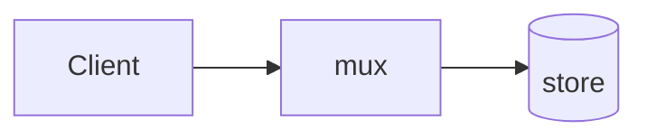

## Endpoints

| Method | Path | What it does | Auth |
|--------|------|--------------|------|
| GET | /notes | Lists every note, newest first. A long cell wraps in its column. | none |
| POST | /notes | Stores the note in the request body. | token |
| DELETE | /notes/{id} | Deletes one note. | token |

## How a request flows

