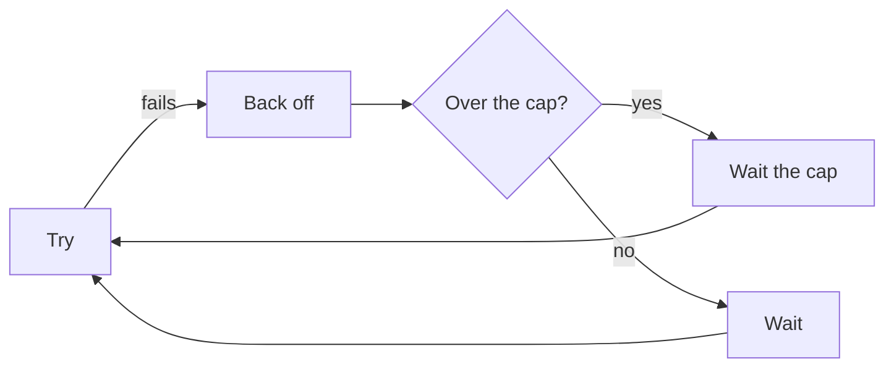

**Plan:** This is how a retry waits now.



```tml
<tml version="1">
  <kv>
    <item k="Runs" v="200"/>
    <item k="Failures" v="0" role="success"/>
    <item k="Longest wait" v="1800ms"/>
  </kv>
</tml>
```
